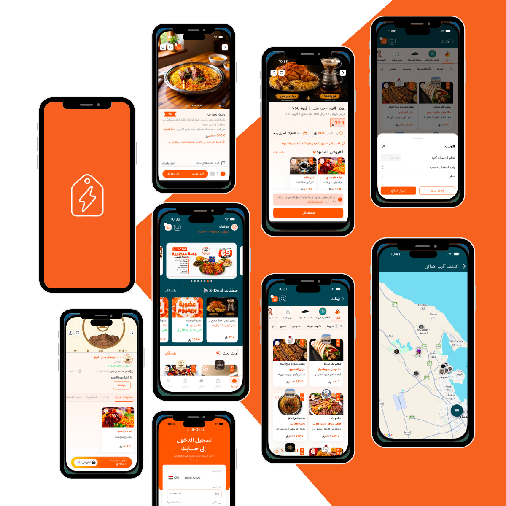
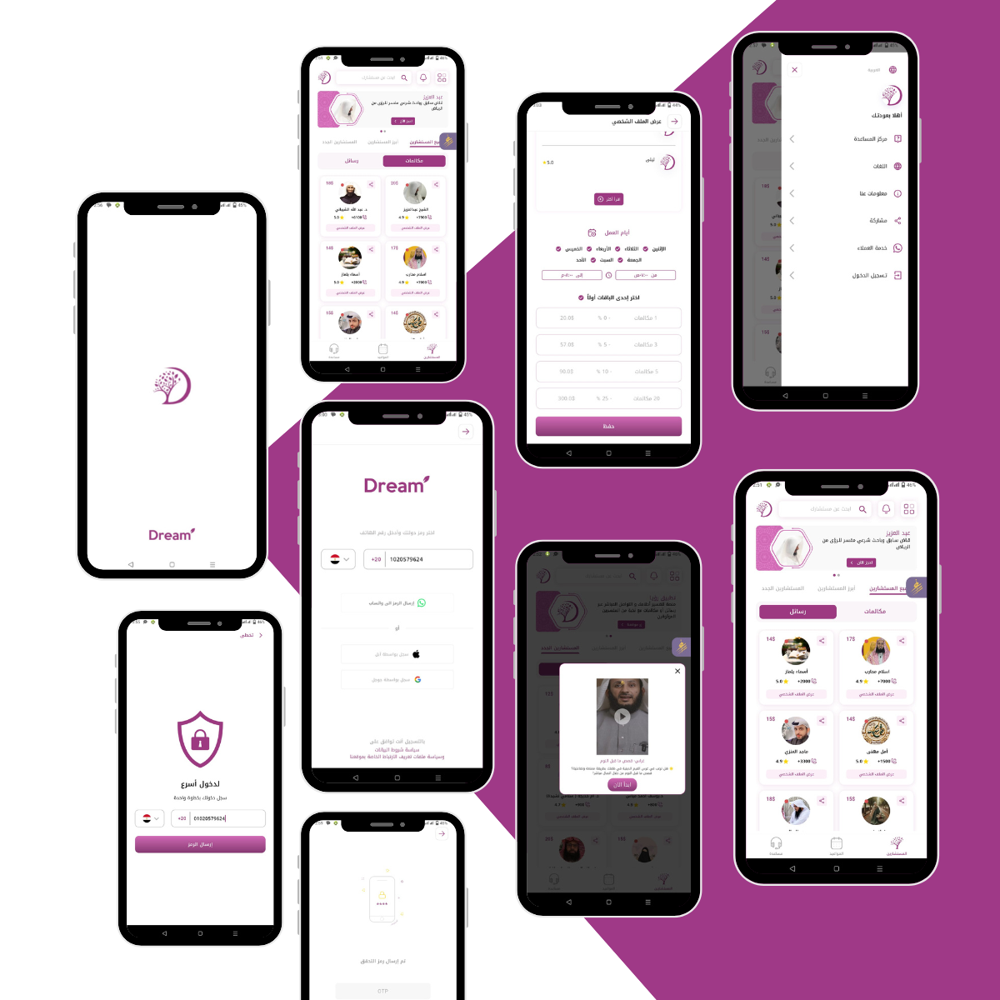
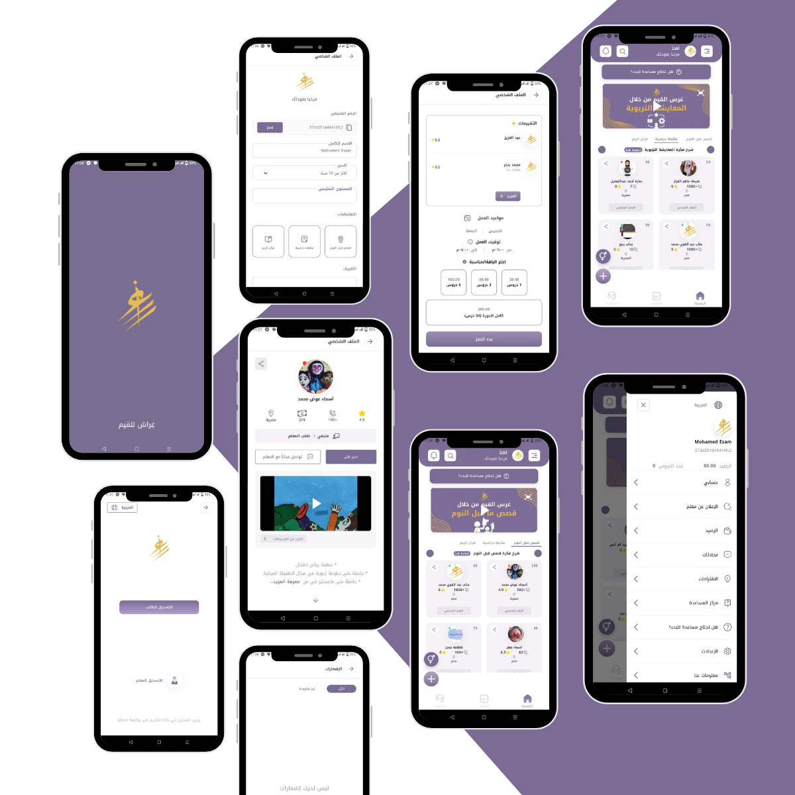
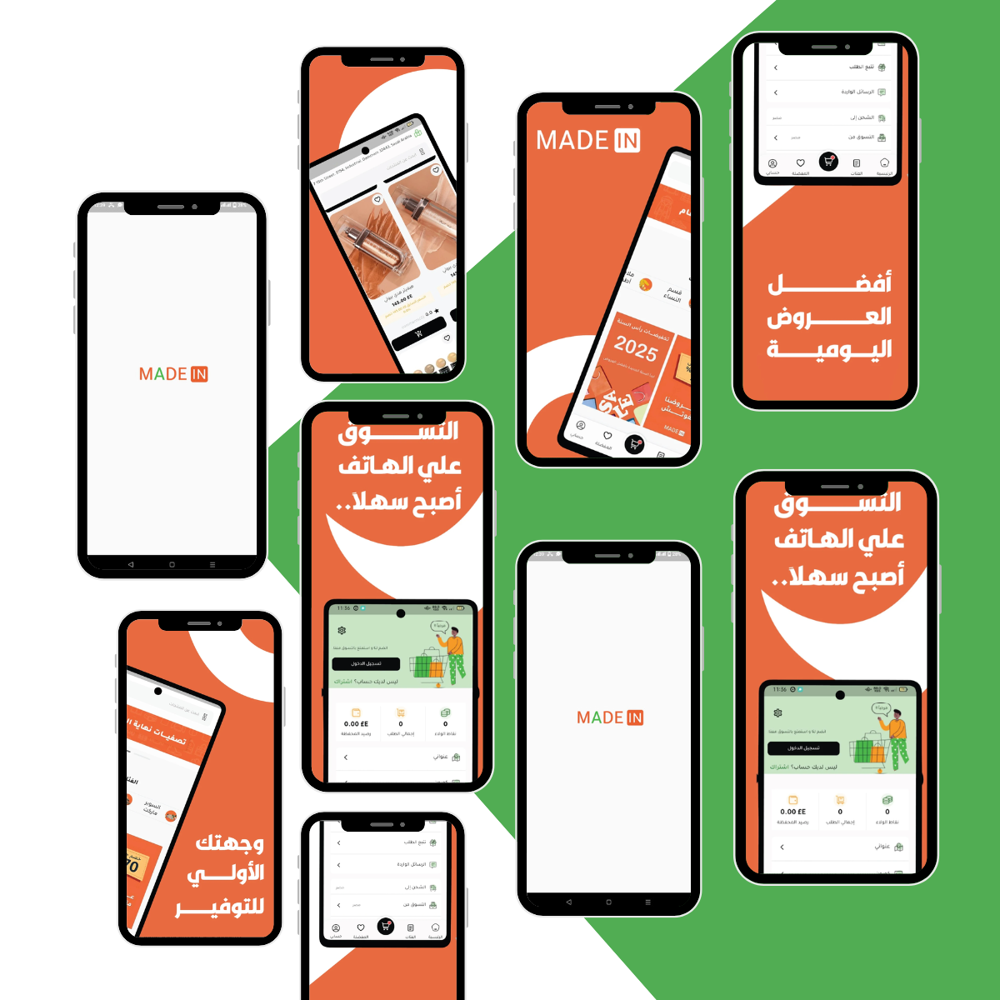

# Hi there, I'm Amr Khafagy 👋

## Flutter Developer | Mobile Application Engineer

Mobile Application Engineer with **4+ years of experience** building reliable, scalable mobile applications with Flutter. I enjoy turning product ideas into polished experiences, from architecture and APIs to production releases.

- 📱 **180K+ total app downloads** across applications I have worked on
- 🛍️ Experience across **E-commerce, POS, Social Platforms, Delivery, and Education**
- 🛡️ Interested in **Web Penetration Testing** and **Bug Bounty**

## What I Do

- Build cross-platform mobile applications with Flutter
- Design maintainable application architecture and clean, testable code
- Integrate REST and GraphQL APIs, Firebase services, and local storage
- Collaborate throughout the product lifecycle, from requirements to release and monitoring

## Featured Projects

- [E-commerce App](https://github.com/amr-khafagy/e_commerce) — Flutter e-commerce application
- [Delivery App](https://github.com/amr-khafagy/delivery) — Flutter delivery application
- [Courses App](https://github.com/amr-khafagy/courses_app) — Flutter education application
- [2048 Game](https://github.com/amr-khafagy/2048-game) — Flutter implementation of the classic 2048 game

## Professional Experience Highlights

> The following are production applications I contributed to professionally. Source code is not published because it belongs to the respective companies.

### S-Deal — Flutter Developer

- Built and maintained Flutter features for e-commerce, social content, and delivery workflows using GetX, Dio, GraphQL, and Laravel APIs.
- Implemented payments, Google Maps, store discovery, geolocation, and delivery tracking.
- Contributed to performance improvements and automated release workflows with GitHub Actions and Firebase App Distribution.
- Available on [Google Play](https://play.google.com/store/search?q=s-deal&c=apps) and the [App Store](https://apps.apple.com/us/app/%D8%A7%D8%B3-%D8%AF%D9%8A%D9%84/id6745791431).

### Dream — Flutter Developer

- Maintained customer and consultant experiences for a multi-role production application.
- Helped migrate legacy MVC and GetX code toward MVVM and Cubit/BLoC patterns.
- Integrated and supported real-time audio and video communication using Agora SDK.
- Available on [Google Play](https://play.google.com/store/apps/details?id=com.abdulazizahmed.dream) and the [App Store](https://apps.apple.com/eg/app/dream-dream-interpretation/id1515745954).

### Jeras (Ghras Al Qiyam) — Flutter Developer

- Built and maintained features for customers, consultants, and support teams.
- Refactored legacy Flutter code into modular, maintainable components and collaborated with backend engineers on API improvements.
- Available on [Google Play](https://play.google.com/store/apps/details?id=com.app.jeras) and the [App Store](https://apps.apple.com/us/app/jeras-%D8%BA%D8%B1%D8%A7%D8%B3/id1612021922).

### Made In — Flutter Developer

- Built and maintained e-commerce and marketplace features with REST/GraphQL APIs, Firebase services, payment flows, and localization.
- Applied Clean Architecture, Repository Pattern, GetIt, and Injectable to improve maintainability.
- Improved Android delivery performance by reducing APK size from 44 MB to 32.9 MB and download time from 30 seconds to 22 seconds.
- Published through the [Google Play developer page](https://play.google.com/store/apps/dev?id=6747219210412872938).

## What I'm Exploring

- Web Penetration Testing
- Bug Bounty

## Skills

**Languages:** Dart, Java, C++

**Mobile Development:** Flutter, GetX, Cubit/BLoC, Platform Channels

**Architecture:** Clean Architecture, MVVM, MVC, Repository Pattern, Dependency Injection

**Networking:** REST, GraphQL, Dio, WebSockets, HTTP

**Firebase & Storage:** Firebase Authentication, Firestore, Realtime Database, Firebase Storage, FCM, Crashlytics, Dynamic Links, SQLite, Shared Preferences, Flutter Secure Storage

**Integrations:** Payment Gateways, Google Maps, Geolocation, Live Tracking, Deep Linking, Push Notifications

**Quality & Delivery:** Unit Testing, Widget Testing, Integration Testing, Mocktail, bloc_test, GitHub Actions, Codemagic, Fastlane, Google Play & App Store Deployment

**Tools:** Git, GitHub, Postman, Swagger, Jira, Sentry, Figma

**Practices:** SOLID, Clean Code, Git Flow, Pull Requests, Code Reviews, Agile/Scrum, Performance Optimization

## Connect With Me

- LinkedIn: [amr-ashraf-2b4673209](https://www.linkedin.com/in/amr-ashraf-2b4673209/)
- Email: [amra0939@gmail.com](mailto:amra0939@gmail.com)
- GitHub: [amr-khafagy](https://github.com/amr-khafagy)
